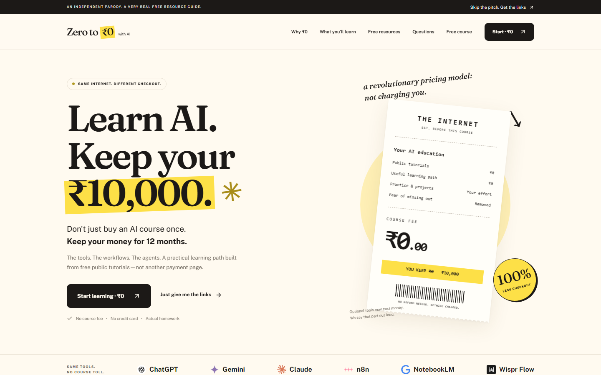
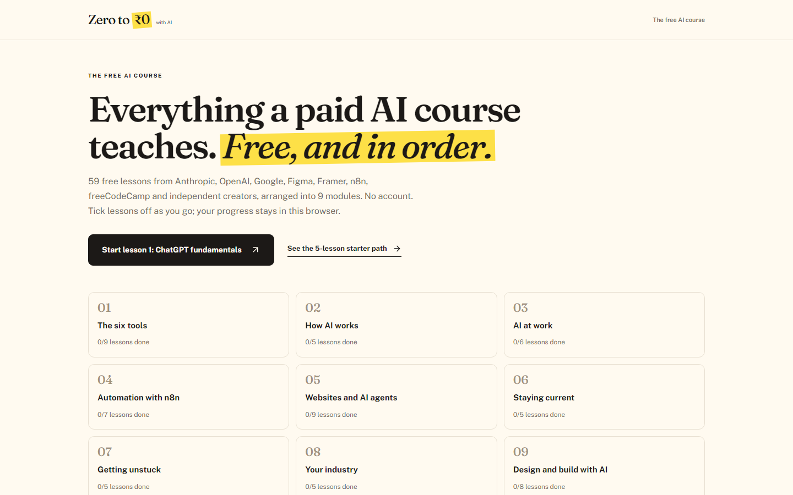

<div align="center">

# Zero to ₹0

**Learn AI. Keep your ₹10,000.**

A free, open-source AI course built from the best free lessons on the internet, plus a gentle parody of paid AI-course marketing.

[**Live site**](https://zeroto.infinitylinkage.com) · [**The free AI course**](https://zeroto.infinitylinkage.com/zerotoinfinity) · [Report a broken link](https://github.com/krutikkkkkkkkk/zero-to-0/issues/new?title=Broken%20or%20outdated%20link%3A%20) · [Suggest a lesson](https://github.com/krutikkkkkkkkk/zero-to-0/issues/new?title=Lesson%20suggestion%3A%20)


</div>



## Why this exists

Paid AI programs for beginners sell a syllabus: the main tools, how AI works, using it at work, automation, building websites and agents, and keeping up. Free material covering every one of those topics already exists from Anthropic, OpenAI, Google, n8n, freeCodeCamp and independent creators. It's just scattered, and nobody tells you what to do first.

Zero to ₹0 puts that free material in order. It hosts no lessons of its own: every lesson opens on its publisher's site. The value is the **selection, the order and the upkeep**.

## The free AI course



65 lessons in 9 modules, taken in order, and every module ends in a **hands-on project** with a clear "done when" check. A **5-lesson starter path** (about 8 hours) gets you using the main chat tools and building one n8n workflow.

| # | Module | You'll be able to | Lessons |
| - | ------ | ----------------- | :-----: |
| 1 | The six tools | Use ChatGPT, Claude, Gemini, Gemini Notebook, Wispr Flow and n8n for one real task each | 9 |
| 2 | How AI works | Explain what a language model does and why it gets things wrong | 5 |
| 3 | AI at work | Use AI for email, research, meeting notes and data, and check its output | 6 |
| 4 | Automation with n8n | Have one repeated task run on its own | 7 |
| 5 | Websites and AI agents | Ship one website and one working agent | 9 |
| 6 | Staying current | Keep up in twenty minutes a week | 5 |
| 7 | Getting unstuck | Know where and how to ask for help | 5 |
| 8 | Your industry | Apply the tools in finance, marketing, HR or a small business | 5 |
| 9 | Design and build with AI | Design a screen with AI tools and let an agent turn it into a working page | 8 |

### Features

- **One page, whole course.** An overview of every module, with lesson counts and progress.
- **A project in every module.** Learners finish with proof of skill, not just a list of watched videos.
- **Find your path.** Three questions (work, goal, time per week) pick a shorter personal path with a time estimate.
- **Progress tracking without an account.** Tick lessons and projects off; progress is saved in your browser only.
- **Progress links.** Copy a link that carries your progress to another device. It stays in the part of the URL that's never sent to a server.
- **Progress cards.** A shareable image of your progress. Self-reported, and clearly not a certificate.
- **Search and filters.** Search by tool or topic ("agents", "Excel", "n8n"), or show only your path, the starter path, courses, videos, reading, tools or communities.
- **Link previews.** Designed social preview images for the home page and the course.
- **Resources section.** AI app builders (v0, Lovable, Bolt, Figma Make) with their free plans and free Vercel hosting and courses, 26 hand-picked free GitHub repos by level, and copy-paste prompt libraries for building websites and making images.
- **Share on LinkedIn and X.** Share the course or your progress; progress posts show your progress card as the preview.
- **Weekly link check.** A GitHub Action opens every lesson link each Monday and opens an issue if any break.
- **Honest labels.** Publisher, type and duration (only where the publisher states it) on every lesson, and any paid plan called out in the description.
- **Phone-friendly and keyboard accessible.**
- **Privacy-first.** No cookies, no ads, no cross-site trackers. Anonymous page-view counts (Vercel Web Analytics) and one public visit counter are the only data collected.

## Tech stack

- [Next.js 16](https://nextjs.org) (App Router, static pages) and [Tailwind CSS 4](https://tailwindcss.com)
- [lucide-react](https://lucide.dev) for UI icons and [Simple Icons](https://simpleicons.org) for publisher logos
- [Upstash Redis](https://upstash.com) for the visit counter
- Hosted on [Vercel](https://vercel.com)

## Run it locally

Requires Node.js 20 or newer.

```bash
git clone https://github.com/krutikkkkkkkkk/zero-to-0.git
cd zero-to-0
npm install
npm run dev
```

Open [http://localhost:3000](http://localhost:3000).

### Environment variables (optional)

Only the footer's visit counter needs them. Without them the site works normally and the counter stays hidden.

| Variable | What it is |
| -------- | ---------- |
| `KV_REST_API_URL` | Upstash Redis REST URL |
| `KV_REST_API_TOKEN` | Upstash Redis REST token |

On Vercel, connecting an Upstash for Redis store to the project sets both automatically. Locally, put them in `.env.local`.

## Project structure

```
app/
  page.tsx               Home page (the parody)
  zerotoinfinity/        The free AI course
  privacy/  terms/       Legal pages
  api/visits/route.ts    Visit counter endpoint
  progress-card/         Shareable progress card image
  progress/[stats]/      Share pages that give LinkedIn and X posts a progress-card preview
  resources/             GitHub repos, website prompts and image prompts
  opengraph-image.tsx    Social preview images (also in zerotoinfinity/)
  globals.css            Tailwind theme: colours, fonts, breakpoints
components/
  course/                Course page and its browser-saved progress
  site-footer.tsx        Footer used on every page
  brand-logo.tsx         Publisher logos
lib/
  course.ts              Every course lesson and module project (edit this to change the course)
  paths.ts               The "find your path" quiz and the lessons each answer picks
  search.ts              Extra search words for lessons
  resources.ts           Resources pages: repos and prompt libraries (edit this to add one)
  builders.ts            AI app builders, Vercel resources and builder prompts
  content.ts             Copy and resources for the home page
scripts/check-links.mjs  Opens every link and reports broken ones (npm run check-links)
assets/fonts/            Fonts for generated images (SIL Open Font License)
public/logos/            Logos not available in Simple Icons
```

## Adding or changing a lesson

All lessons live in [`lib/course.ts`](lib/course.ts). The page reads that file, so you never need to touch layout code. Each lesson looks like this:

```ts
{
  id: "anthropic-claude-101",            // permanent: saved progress uses it, so never rename or reuse
  title: "Claude 101",                    // the title as the publisher gives it
  publisher: "Claude Academy (Anthropic)",
  type: "Course",                         // Course | Video | Reading | Tool | Community
  url: "https://academy.claude.com/courses/claude-101",
  duration: "2.5 hr",                     // only if the publisher states it
  description: "One line on what it teaches and who it suits.",
  starter: true,                          // marks the 5-lesson starter path
  lastChecked: "2026-11-23",              // date someone last opened the link
}
```

Rules for lessons:

1. **Free to open.** If a feature or tool needs a paid plan, say so in the description.
2. **Link to the source.** Creator links go to the channel itself, and catalog links go to the specific course, not a search page.
3. **Open the link before adding it**, and update `lastChecked`.
4. If a new publisher needs a logo, add it in [`components/brand-logo.tsx`](components/brand-logo.tsx).
5. Optionally add it to a path in [`lib/paths.ts`](lib/paths.ts) and add search words in [`lib/search.ts`](lib/search.ts).

## Contributing

Contributions are welcome, especially:

- Reporting dead or outdated links ([open an issue](https://github.com/krutikkkkkkkkk/zero-to-0/issues/new?title=Broken%20or%20outdated%20link%3A%20))
- Suggesting excellent free lessons, particularly for finance, HR and non-English learners
- Accessibility and performance fixes

Before opening a pull request, run:

```bash
npm run lint
npm run build
npm run check-links   # if you added or changed a lesson link
```

## Privacy

No accounts, no cookies, no ads, no cross-site trackers. Course progress stays in your browser. On the server there's one number (the total visit count), plus anonymous page-view totals from Vercel Web Analytics. See the full [privacy policy](https://zeroto.infinitylinkage.com/privacy).

## Support the project

The course is free and will stay free. If it helped you, you can [sponsor on GitHub](https://github.com/sponsors/krutikkkkkkkkk). Entirely optional.

Made by [Krutik Raut](https://x.com/krutikkkkkkkkk).

## License and credits

The code and site text are released under the [MIT License](LICENSE).

Every lesson belongs to its publisher and opens on their own site; this project only selects and orders them. Publisher logos come from [Simple Icons](https://simpleicons.org) (CC0) or from each publisher's own website. They are trademarks of their owners and are used only to identify who made each lesson; no endorsement is implied. Generated images use [Fraunces](https://github.com/undercasetype/Fraunces) and [Public Sans](https://github.com/uswds/public-sans), both under the SIL Open Font License.

Zero to ₹0 is an independent parody. It is not affiliated with Zero to Infinity with AI or its instructors, and the satire is not an allegation of misconduct.
